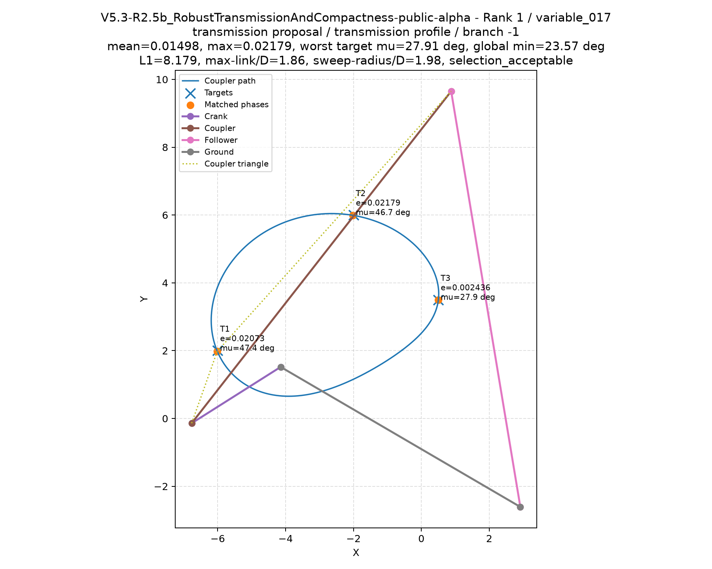

# Mechanism Generator

**Designing linkages and cam mechanisms to a written specification, and grading the results the way a test engineer would: with the tests fixed before the run, and with failures kept as data.**

This is a research project, not a product. It has an open task-specification format, a planar four-bar search engine, and a private library that designs nine mechanism families, picks between them for a brief, and puts several of them together into a small production line that is checked as a whole. It has not yet produced a mechanism that was built and tested in hardware. This page says what works, what does not, and how the work was done.

**[Watch a designed line run →](https://run.mechanismo.ai/index-table-line.html)** A three-station line with an index table in the middle, designed from its brief and played in your browser from the same data as its CAD model.

**[Try the four-bar playground →](https://mechanismo-ai.github.io/mechanism-design-ml/)** Drag a few target points and it designs a linkage that traces a path through them, in your browser.

## What exists

- **OMTS, an open task-specification format for mechanisms.** A task says where a part must be carried, held or flipped, and to what tolerance, including timing, synchronization, collision geometry and dwell demands. Validation is strict: an unsupported feature is rejected loudly, never dropped silently.
- **A planar four-bar research engine**, the project's first phase, plus an experimental six-bar motion solver. It searches candidate mechanisms against three-pose tasks, checks each one against physical and kinematic criteria, and exports every candidate with its evidence. It is published, with its three learned proposal models as open weights, as a frozen release in the public repository `mechanism-generator-classic`.
- **A mechanism selector (private).** Nine families: four-bar, geared five-bar, slider-crank, dwell linkage, plate cam, barrel cam, rocker cam, and two drives for rotary index tables, the Geneva and the parallel cam indexer. Each has its own search and its own independent verifier, written with a different method from the solver. Given a brief, the selector collects every verified design, filters by the space the brief allows, and keeps only designs that still work when built wrong.
- **A robustness floor (private).** Every candidate is graded on simulated copies built with errors of the size the brief states (±0.05 mm for machined parts, ±0.2 or ±0.3 mm for printed ones). A design is ranked only if at least 90% of its copies still meet the brief, and then only if it does so again on fresh copies it was not chosen on. A brief can set its own floor.
- **Dynamics and loads (private).** A brief can limit acceleration, jerk, motor torque, transmission angle, speed on arrival, path deviation, the carried part's clearance, and the forces on pins, bearings and cam contacts, over the whole cycle or only while the part is carried. All nine families are analysed.
- **Lines of mechanisms (private).** Several stations on one master cycle, handing a part from one to the next. A line is checked as a whole: its timing, every hand-over, collisions between everything that moves through the full cycle, the grippers, and then 100 mis-built copies of the entire line. One command goes from a line's brief to a checked line and its drawings.
- **CAD output (private).** Every design is written as cut outlines (DXF) and as a FreeCAD model that plays its cycle, from the same data the checks read. A line is written as one model with every station in place.
- **Browser playback.** Each line is also written as a single web page that plays it from ten viewing directions, each view checked against the model. One is public, linked at the top of this page.
- **A browser playground** (above) with a simplified four-bar path generator anyone can use without installing anything.
- **Recorded case studies** (below), each following the same loop: a plain-language brief, a measured failure of the current engine, a capability design, and a decision.

## What does not exist yet

- No mechanism from this project has been built or tested on a bench. Every result below is an analysis on a computer.
- Everything is validated on constructed briefs, not on a collection of real customer briefs.
- In a line, the grippers, frames and drives are stand-ins with stated requirements (a vacuum cup that must hold a given mass, a base plate of a given size), not designed parts. Fasteners, wiring and guarding are not modelled.
- Forces are computed, but parts are not sized against them: there is no strength, wear or life analysis.
- The lines that work hand parts over through fixed nests or an index table's pockets. A line in which two moving grippers hand a part directly to each other has not been shown to work.
- The flip-station case is unsolved.

## Case studies

Each outcome below is a recorded result. None involves a built mechanism.

| Case | Task | What was recorded |
|---|---|---|
| Dwell station | Hold a carried point within 0.3 mm for at least 50° of crank rotation | The best four-bar candidates missed the stillness demand by 203.69×. A cam dwell-arc design analysis reaches a nominal 53.8° dwell width, with a guaranteed 52.7° at a 0.05 mm tolerance class. The selector's pick today is a rocker cam of 261 mm envelope radius that keeps 90% of its 40 simulated mis-built copies (±0.05 mm) and 94% of 80 fresh ones; the smallest verified barrel cam is 678 mm. A design analysis, not a built part. |
| Gap transfer | Carry a part level across a 260 mm gap at packaging tolerance | Successive six-bar attempts stayed well above tolerance (as high as about 27× in the last recorded iteration). A dual-cam and lever design analysis then met its pressure-angle gate (worst case 29.7° against a 30° limit, a thin margin) inside a declared 600 × 600 mm envelope. The envelope is an assumption, not a derived requirement. The selector's pick today is a rocker cam of 216 mm envelope radius, which keeps every mis-built copy, over a 286 mm slider-crank; the best four-bar it found needs 947 mm. |
| Flip station | Flip a flat part 180° between stations | Both families tried, a groove cam and six-bar linkages, failed on their own instruments. Recorded as unsolved, with the evidence kept as data. |

## Choosing the mechanism: what the benchmark shows

The selector is run on 28 constructed briefs: the three case-study briefs plus variations in span, tolerance, dwell, available space and carrier pose. Every pick passes its family's verifier, keeps at least 90% of 40 copies built with ±0.05 mm errors, and does so again on 80 fresh copies. Results from the run of 11 November 2026:

- **27 of 28 briefs get a pick.** Rocker cam 15, barrel cam 5, geared five-bar 5, slider-crank 1, plate cam 1. One brief, a short, wide band with a hold, gets none: the three designs that pass its verifier keep between 42% and 60% of their copies, and the selector refuses them where it used to offer one.
- **The floor changed who wins.** Ranked for robustness with no floor, an earlier run gave the barrel cam 11 briefs and the rocker cam 9. With the floor, the smaller of the designs that clear it wins, and that is usually a rocker cam.
- **A pick chosen on noisy grades can be flattered.** When confirmation on fresh copies was introduced, it set aside two designs that had passed on the copies they were chosen on.
- **An honest pressure angle costs size.** Cams are held to the textbook limits (30° for a sliding follower, 45° for a swinging one) and designed half a degree inside them, so a small build error does not push a copy over. That margin makes the plate and barrel cams 1 to 2% larger.
- **The space decides the family.** Briefs whose carrier tilts go to the geared five-bar (90 mm on the tabletop brief against the four-bar's 244).
- **Printed builds lose a few.** At ±0.2 mm, the tolerance of a typical desktop print, 24 of the 28 briefs keep a pick.

A review of the work by fresh reviewers on 29 October found, among other things, a showcase cam running at a 61° pressure angle and a benchmark comparison skewed by an unequal search. Both were fixed, and the numbers on this page come from committed run records.

## Lines: several mechanisms working together

A line's brief says what part moves, how far apart the stations stand, the cycle time and the build accuracy. One command picks a mechanism for every station, lays the line out, times it, checks it and draws it. On a two-core machine that takes twenty minutes to two hours, much of it the mis-built copies.

| Line | What it is | Result |
|---|---|---|
| Puck line | Three transfers passing a 25 mm puck through two fixed nests, on a 2 s cycle, built to ±0.3 mm | Works as designed, and on 100 of 100 mis-built copies |
| Test line A | Five stations, two of them holding the puck still for a labelling stop | Works as designed, and on 100 of 100 copies |
| Test line B | A six-stop index table between two transfers (the line linked at the top of this page) | Works as designed, and on 99 of 100 copies. The one failure is the table's own drive, at the rate its 95% robustness predicts |
| Test line C | A carton turned a quarter turn by a four-stop table | In progress |

Each test line is run through the command as it stands, and every break is written down before anything is fixed. That list is the point of the exercise. Two examples: on test line A a station's cam drum was laid out across the line, through its neighbours; on test line C the carton was given a half turn where the brief asked for a quarter, and every check passed, because nothing yet compared which way a part faced. Both are fixed, with a test that fails without the fix.

## What the learned models showed

The project began as a machine-learning one, and the case studies gave it a test bed for comparing learned models with exact methods. Everything in this section is on small synthetic problems.

- **A learned model failed outside its training range, and the cause was found.** On one cam-groove family, a model matched the exact solution inside its training range and was about 18,000 times worse outside it, 13 times the tolerance. A controlled check traced that to a missing input. With the input added, the error outside the range came back to within 10% of the error inside. That shows the cause was identified. It does not show the approach generalises to other families.
- **Learned starting points saved effort, not error.** Starting a search from the learned model matched or beat random restarts on 16 of 16 demands, with about a tenth of the evaluations (22 against 212 on average). That is a cost result, not a better answer.
- **The learned models never beat the exact methods.** On 60 four-bar position tasks, the published proposal models led to a usable design on 28. The best of 128 random proposals reached 53, and a portfolio with no learned models reached all 60. That is one corpus and one seed, but it was enough to stop training the proposal models.

After that, the work moved to proprietary search methods with independent checks, which is the library described above. My current view is that learning is most likely to help with choosing and combining mechanisms, not with the precise sizing that closed-form methods already do well.

## How experiments were run

Every experiment followed one protocol: the scorecard and decision rules were written down before the run, predictions were graded against the result, and a refuted prediction was recorded as a finding and never quietly re-run. Instruments fail loudly on bad inputs. Runs were recorded only when two independent executions matched byte for byte. This was useful for grading learned models honestly. It also produced a lot of process, and the next step is to point the same effort at building a mechanism that works.

## Next

Private work continues on the third test line, on sets of mechanisms that draw a given shape between them, and on taking one design through to a built mechanism measured against its prediction. I’m happy to discuss it.

## Try it

The playground designs a crank-rocker four-bar whose coupler point passes through 3 to 6 points you place in a 200 × 140 mm work area. It animates up to three designs and reports the error at each point, the minimum transmission angle and every dimension, and it can copy a design out as JSON. It usually finds designs within a few hundredths of a millimetre in a second or two.

It uses a simplified solver written for the page (random valid designs, then Nelder–Mead refinement), not the project's research engine. It checks kinematics only: position, full crank rotation and transmission angle. The page is a single file, `docs/index.html`, and also runs offline if you save it. Slider-crank, cam and six-bar versions are planned.

*A design from the research engine for a three-point task. It passed the engine's practical selection checks but not all of its preferred engineering thresholds, and it is not hardware-validated.*

## Related work

This project is a small part of a fast-moving field. The [LINKS dataset](https://arxiv.org/abs/2208.14567) provides a hundred million simulated planar linkages for data-driven design, and [MechaFormer](https://arxiv.org/abs/2508.09005) generates mechanisms as sequences with a transformer. Both advance the models. This project works on a different part of the problem: the written specification, and the checking that decides whether a generated mechanism can be trusted.

## About this repository

This is a public summary. The full engineering record is kept in a private repository, and I'm glad to share it on request. The project's mission and review standards are in the [community repository](https://github.com/Mechanismo-AI/mechanism-generator-community).

Python: the classic engine uses PyTorch and NumPy; the mechanism library uses NumPy and SciPy only; YAML and JSON-schema validation. This repository is Apache-2.0.

## How this was built

I built this with AI coding assistants (Claude, ChatGPT and Mistral). I set the direction, decided what to try next, and reviewed and merged every pull request. The assistants wrote most of the code and drafted most of the experiment documents. The main repository has more than 275 pull requests, and its commit history shows the assistants as co-authors. I'm saying so plainly because a reader should know which parts are my judgment and which are assisted execution.
