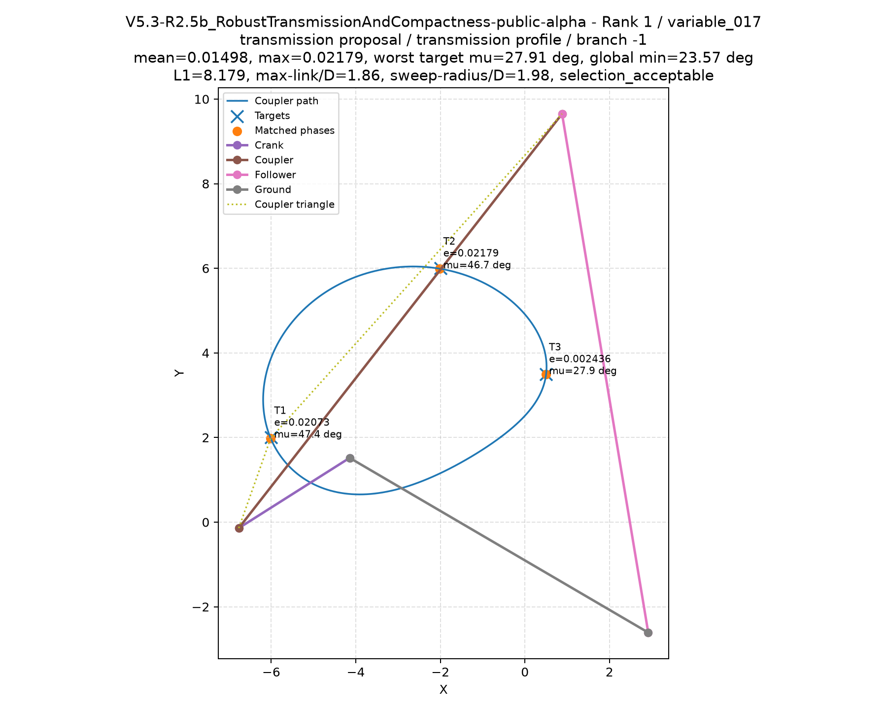

# Mechanism Generator

**Designing linkages and cam mechanisms to a written specification, and grading the results the way an ML project grades a model: with the tests fixed before the run, and with failures kept as data.**

This is a research project, not a product. It has a working planar four-bar search engine, an open task-specification format, and a set of recorded case studies. It has not yet produced a mechanism that was built and tested in hardware. This page says what works, what does not, and how the work was done.

**[Try the four-bar playground →](https://mechanismo-ai.github.io/mechanism-design-ml/)** Drag a few target points and it designs a linkage that traces a path through them, in your browser.

## Try it

The [playground](https://mechanismo-ai.github.io/mechanism-design-ml/) designs a crank-rocker four-bar whose coupler point passes through 3 to 6 points you place in a 200 × 140 mm work area. It animates up to three designs and reports the error at each point, the minimum transmission angle and every dimension, and it can copy a design out as JSON. It usually finds designs within a few hundredths of a millimetre in a second or two.

It uses a simplified solver written for the page (random valid designs, then Nelder–Mead refinement), not the project's research engine. It checks kinematics only: position, full crank rotation and transmission angle. The page is a single file, [`docs/index.html`](docs/index.html), and also runs offline if you save it. Slider-crank, cam and six-bar versions are planned.

*A design from the research engine for a three-point task. It passed the engine's practical selection checks but not all of its preferred engineering thresholds, and it is not hardware-validated.*

## What exists

- **OMTS, an open task-specification format for mechanisms.** A task says where a part must be carried, held or flipped, and to what tolerance, including timing, synchronization, collision geometry and dwell demands. Validation is strict: an unsupported feature is rejected loudly, never dropped silently.
- **A planar four-bar research engine**, plus an experimental six-bar motion solver. It searches candidate mechanisms against three-pose tasks, checks each one against physical and kinematic criteria, and exports every candidate with its evidence.
- **Verification tooling** for lines of mechanisms that must work together: master-cycle synchronization, per-task phase offsets, and sampled collision occupancy.
- **A browser playground** (above) with a simplified four-bar path generator anyone can use without installing anything.
- **Recorded case studies** (below), each following the same loop: a plain-language brief, a measured failure of the current engine, a capability design, and a decision.

## What does not exist yet

- No mechanism from this project has been built or tested on a bench. Every result below is a kinematic or design analysis on a computer.
- Dynamics, loads, manufacturability and physical clearance are not rated.
- The engine is validated on constructed test tasks, not on a collection of real customer briefs.
- The flip-station case is unsolved.

## Case studies

Each outcome below is a recorded result. None involves a built mechanism.

| Case | Task | What was recorded |
|---|---|---|
| Dwell station | Hold a carried point within 0.3 mm for at least 50° of crank rotation | The best four-bar candidates missed the stillness demand by 203.69×. A cam dwell-arc design analysis reaches a nominal 53.8° dwell width, with a guaranteed 52.7° at a 0.05 mm tolerance class. This is a design analysis, not a built part. |
| Gap transfer | Carry a part level across a 260 mm gap at packaging tolerance | Successive six-bar attempts stayed well above tolerance (as high as about 27× in the last recorded iteration). A dual-cam and lever design analysis then met its pressure-angle gate (worst case 29.7° against a 30° limit, a thin margin) inside a declared 600 × 600 mm envelope. The envelope is an assumption, not a derived requirement. |
| Flip station | Flip a flat part 180° between stations | Both families tried, a groove cam and six-bar linkages, failed on their own instruments. Recorded as unsolved, with the evidence kept as data. |

## The learned-model results, good and bad

The case studies produced machine-readable records of solved and failed tasks, which became a test bed for comparing learned models against exact analytic methods. All results below come from small synthetic problems.

**Learned model, extrapolation failure.** On one cam-groove family, a ridge-regression model with Fourier features matched the analytic solution in-distribution (median error 8.4e-6 units). Under a shift in the design variable, the median error rose to 0.15 units, about 17,930 times larger and 13 times the 0.015-unit tolerance. A controlled check traced this to missing information: the design variable was not an input to the model.

**The fix, on that family.** Adding the design variable as an input brought the extrapolation median down to about 9.2e-6 units, a ratio to the in-distribution error of about 1.10× (1.0983× recorded). This held on a small grid of 6 training cells and 4 extrapolation cells. It shows the cause was correctly identified. It does not show the approach generalizes to other mechanism families.

**Learned starting points.** Warm-starting a search from the learned model won or tied in 16 of 16 demands, using about a tenth of the oracle calls of random restarts (mean 22.0 against 211.5). That is a cost result. It does not show better answers.

**The honest part.** The learned model has never beaten the analytic closed-form solution on the tested family, so it is still labeled a supplier output, not a capability. In other parts of the project, learned components also did no better than random restarts. A recent comparison on a synthetic four-bar test set points the same way, and I'm treating it as preliminary until it has been re-run and written up. My current view is that learning is most likely to help with choosing and combining mechanisms, not with the precise sizing that closed-form methods already do well.

## How experiments were run

Every experiment followed one protocol: the scorecard and decision rules were written down before the run, predictions were graded against the result, and a refuted prediction was recorded as a finding and never quietly re-run. Instruments fail loudly on bad inputs. Runs were recorded only when two independent executions matched byte for byte. This was useful for grading learned models honestly. It also produced a lot of process, and the next step is to point the same effort at building a mechanism that works.

## Next

Private work continues on widening the range of mechanism types and on taking a practical brief through to a built mechanism. I’m happy to discuss it.

## Related work

This project is a small part of a fast-moving field. The [LINKS dataset](https://arxiv.org/abs/2208.14567) provides a hundred million simulated planar linkages for data-driven design, and [MechaFormer](https://arxiv.org/abs/2508.09005) generates mechanisms as sequences with a transformer. Both advance the models. This project works on a different part of the problem: the written specification, and the checking that decides whether a generated mechanism can be trusted.

## About this repository

This is a public summary. The full engineering record is kept in a private repository, and I'm glad to share it on request. The project's mission and review standards are in the [community repository](https://github.com/Mechanismo-AI/mechanism-generator-community).

Python, with a PyTorch and NumPy engine and YAML and JSON-schema validation. Apache-2.0.

## How this was built

I built this with AI coding assistants (Claude, ChatGPT and Mistral). I set the direction, decided what to try next, and reviewed and merged every pull request. The assistants wrote most of the code and drafted most of the experiment documents. The main repository has more than 120 pull requests, and its commit history shows the assistants as co-authors. I'm saying so plainly because a reader should know which parts are my judgment and which are assisted execution.
